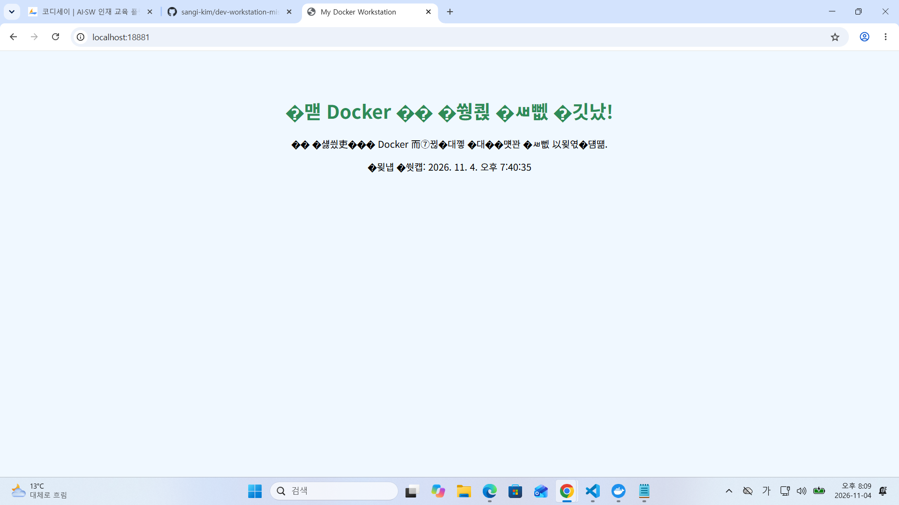

# 개발 워크스테이션 구축 및 데이터 수집 프로젝트

이 저장소는 Linux, Git, Docker, Python을 활용해 개발 환경을 구축하고,  
외부 API 데이터를 수집·가공한 과정을 정리한 프로젝트입니다.

---

## 1. 실행 환경

- **OS**: Ubuntu
- **Shell**: bash
- **Version Control**: Git, GitHub
- **Container**: Docker, Nginx
- **Language**: Python 3.x
- **Library**: requests

---

## 2. 수행 체크리스트

- [x] 터미널 기본 조작 및 폴더 구성
- [x] 파일/디렉터리 권한 변경 실습
- [x] Docker 설치 및 동작 점검
- [x] Hello-world 컨테이너 실행 확인
- [x] Python 가상환경(venv) 구성
- [x] requests 패키지 설치
- [x] 외부 API 데이터 수집
- [x] 수집 데이터 필터링 및 저장
- [x] Dockerfile 기반 웹 서버 이미지 빌드
- [x] 포트 매핑 접속 확인
- [x] 바인드 마운트 반영 확인
- [x] Git 설정 및 GitHub 연동 완료
- [x] 수행 로그 및 README 정리 완료

---

## 3. 프로젝트 개요

이 프로젝트에서는 다음 내용을 수행했습니다.

1. Linux 터미널과 권한 관리 실습
2. Git/GitHub 및 Docker 기본 사용법 확인
3. Python 가상환경 구성 및 패키지 설치
4. 외부 API 데이터 수집 및 필터링
5. Docker 기반 웹 서버 구성 및 포트/볼륨 설정

---

## 4. Mission 수행 기록

### Mission 1. 개발 환경 및 도구 설정

- **내용**: Git 설치, Docker 기본 점검, Linux 명령어 및 권한 설정 실습
- **상세 로그**: [01-environment.md](./evidence/01-enviroment.md)

- **수행 결과**
  - 개발 환경의 기본 구조를 확인함
  - `chmod`를 이용해 파일 권한을 변경함
  - Docker와 원격 저장소 연동 흐름을 점검함

---

### Mission 2. Python 개발 환경 구축

- **내용**: Python 가상환경(venv) 생성 및 패키지 설치
- **상세 로그**: [04-python-env.md](./evidence/04-python-env.md)

- **수행 결과**
  - 프로젝트별 독립 환경을 구성함
  - `requests` 패키지를 설치하여 HTTP 통신 환경을 준비함
  - 패키지 관리의 필요성을 이해함

---

### Mission 3. 데이터 수집 및 가공

- **내용**: 외부 API(JSON) 데이터를 수집하고 조건에 맞는 항목만 필터링하여 저장
- **상세 로그**: [03-data-collection.md](./03-data-collection.md)

- **수행 결과**
  - `fetch_data.py`로 API 데이터를 수집함
  - `filtered_data.py`로 조건에 맞는 데이터만 추출함
  - 원본 데이터와 가공 데이터를 분리 저장함

---

### Mission 4. Docker 웹 서버 재구축 및 볼륨 설정

- **내용**: Nginx 기반 웹 서버 이미지를 빌드하고 포트 포워딩 및 볼륨 마운트를 적용
- **상세 로그**: [mission4.md](./dev-workstation-mission/mission4.md)

- **수행 결과**
  - Dockerfile로 커스텀 웹 서버 이미지를 빌드함
  - `-p 18881:80` 옵션으로 포트 포워딩을 설정함
  - `-v` 옵션으로 호스트와 컨테이너를 연결함
  - 브라우저 접속을 통해 정상 동작을 확인함

---

## 5. 수행 로그

### Linux / 권한 실습

```bash
pwd
ls -la
chmod 755 example.sh
```

### Python 가상환경 구성

```bash
python3 -m venv .venv
source .venv/bin/activate
pip install requests
```

### 데이터 수집 및 필터링 실행

```bash
python fetch_data.py
python filtered_data.py
```

### Docker 이미지 빌드 및 컨테이너 실행

```bash
docker build -t my-web:1.0 .
docker run -d -p 18881:80 --name my-web-container my-web:1.0
curl http://localhost:18881
```

---

## 6. 결과 화면


---

## 7. 주요 결과

- API 응답 데이터를 파일로 저장함
- 조건에 맞는 데이터만 별도 JSON 파일로 저장함
- Docker 기반 웹 서버를 구성하고 접속을 확인함
- 포트 포워딩과 볼륨 마운트의 동작을 이해함
- GitHub 저장소에 프로젝트 결과물을 정리하여 업로드함

---

## 8. 트러블슈팅

### 1) 웹 페이지 한글 깨짐


에러 화면



---
- **문제**: 브라우저에서 한글이 깨져 보임

- **원인**: HTML 문서에 UTF-8 인코딩 설정이 없었음
- **해결**: HTML 파일의 `<head>` 영역에 아래 코드를 추가함

```html
<meta charset="UTF-8">
```

---

### 2) 컨테이너 이름 충돌

- **문제**: `docker run` 실행 시 동일한 이름의 컨테이너가 이미 존재한다는 오류가 발생함
- **원인**: 이전에 실행했던 컨테이너가 삭제되지 않은 상태였음
- **해결**: 기존 컨테이너를 삭제한 뒤 다시 실행함

```bash
docker rm -f my-web-container
docker run -d -p 18881:80 --name my-web-container my-web:1.0
```

---

## 9. 정리 및 느낀 점

이번 프로젝트를 통해 Linux 명령어, Git/GitHub, Docker, Python 가상환경, API 데이터 수집 과정을 한 흐름으로 실습했습니다.

특히 Docker의 포트 매핑과 볼륨 마운트를 직접 확인하면서 컨테이너와 호스트 환경이 어떻게 연결되는지 이해할 수 있었습니다. 또한 Python을 이용해 외부 API 데이터를 수집하고 조건에 맞게 필터링하면서 데이터 처리의 기본 흐름을 경험했습니다.

이번 실습을 바탕으로 이후에는 Docker Compose, 환경 변수 관리, 자동화 스크립트 작성 등으로 개발 환경을 더 체계적으로 구성해보고 싶습니다.