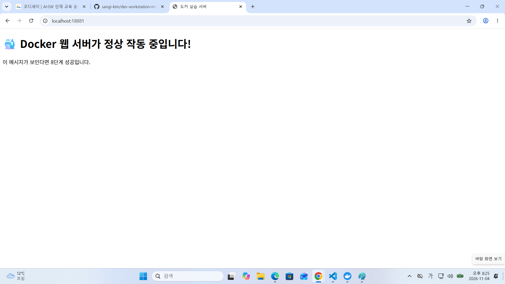

# 🚀 개발 워크스테이션 구축 및 데이터 수집 프로젝트

이 저장소는 개발 환경 구축(Git, Docker, Linux)부터 파이썬을 활용한 실전 데이터 수집까지의 모든 과정을 기록한 프로젝트입니다.

---

## 🛠 사용 기술
- **Operating System**: Linux (Ubuntu)
- **Version Control**: Git, GitHub
- **Container**: Docker, Nginx
- **Language**: Python 3.x
- **Library**: requests

---

## 📚 Mission 수행기록

### [Mission 1] 개발 환경 및 도구 설정
- **내용**: Git 설치, Docker 기본 점검, Linux 명령어 및 권한 설정 실습
- **상세 로그**:[01-environment.md](./dev-workstation-mission/evidence/01-environment.md)
- **핵심 성과**:
  - 개발 환경의 기본 구조를 이해하고 터미널 명령어에 익숙해짐
  - `chmod`를 활용해 파일 권한을 조정함
  - Docker 실행 환경을 확인하고 원격 저장소와의 연결 흐름을 이해함

### [Mission 2] Python 개발 환경 구축
- **내용**: Python 가상환경(venv) 생성 및 패키지 설치
- **상세 로그**: [04-python-environment.md](./dev-workstation-mission/evidence/04-python-env.md)
- **핵심 성과**:
  - `venv`를 활용해 프로젝트별 독립된 Python 환경을 구성함
  - `requests` 라이브러리를 설치하여 HTTP 통신 준비를 완료함
  - 외부 패키지 관리의 필요성과 장점을 이해함

### [Mission 3] 데이터 수집 및 가공 (실전)
- **내용**: 외부 API(JSON) 데이터를 수집하고, 조건에 맞는 항목만 필터링하여 별도 파일로 저장
- **상세 로그**: [03-data-collection.md](./03-data-collection.md)
  - `fetch_data.py`를 통해 API 응답 데이터를 수집하고 `result.json`으로 저장
  - `filtered_data.py`를 통해 `completed: true` 조건의 항목만 추출
  - 원본 데이터와 가공 데이터를 분리 저장하는 흐름을 구현함

### [Mission 4] Docker 웹 서버 재구축 및 볼륨 설정
- **내용**: Nginx 기반 웹 서버 이미지를 빌드하고, 포트 포워딩과 볼륨 마운트를 적용하여 웹 서버를 재구축
- **상세 로그**: [mission4.md](./dev-workstation-mission/mission4.md)
- **핵심 성과**:
  - Dockerfile을 사용해 커스텀 웹 서버 이미지를 빌드함
  - `-p 18881:80` 옵션으로 포트 포워딩을 설정함
  - `-v` 옵션으로 호스트와 컨테이너를 연결해 파일 변경 사항이 즉시 반영되도록 구성함
  - 브라우저 접속을 통해 웹 페이지 정상 동작을 확인함
---
## 🖼 결과 화면

---

## 🧪 주요 결과

### 데이터 수집
- API 응답을 받아 `result.json` 파일로 저장함
- 필터링 조건에 맞는 데이터만 추출하여 `filtered_tasks.json` 파일로 저장함

### Docker 웹 서버
- Nginx 기반 컨테이너를 실행하여 웹 서버를 구성함
- `http://127.0.0.1:18881` 접속을 통해 웹 페이지 확인 가능
- 볼륨 마운트를 통해 로컬 수정 사항이 컨테이너에 즉시 반영됨

---

## 🛠 트러블슈팅

### Case 1: 웹 페이지 한글 깨짐 현상
- **문제**: 브라우저에서 한글이 깨져 보이는 현상이 발생함
- **원인**: HTML 문서에 UTF-8 인코딩 설정이 없었음
- **해결**: `<meta charset="UTF-8">` 태그를 추가하여 해결함

### Case 2: 컨테이너 이름 충돌 에러
- **문제**: `docker run` 실행 시 동일한 이름의 컨테이너가 이미 존재한다는 오류가 발생함
- **원인**: 이전에 생성한 컨테이너가 남아 있었음
- **해결**: 기존 컨테이너를 삭제한 뒤 다시 실행함
```bash
docker rm -f my-web-container
```

## 9. 정리 및 느낀 점

이번 프로젝트를 통해 Linux 명령어, Git/GitHub, Docker, Python 가상환경, API 데이터 수집 과정을 한 흐름으로 실습했습니다.

특히 Docker의 포트 매핑과 볼륨 마운트를 직접 확인하면서 컨테이너와 호스트 환경이 어떻게 연결되는지 이해할 수 있었습니다. 또한 Python을 이용해 외부 API 데이터를 수집하고 조건에 맞게 필터링하면서 데이터 처리의 기본 흐름을 경험했습니다.

이번 실습을 바탕으로 이후에는 Docker Compose, 환경 변수 관리, 자동화 스크립트 작성 등으로 개발 환경을 더 체계적으로 구성해보고 싶습니다.


